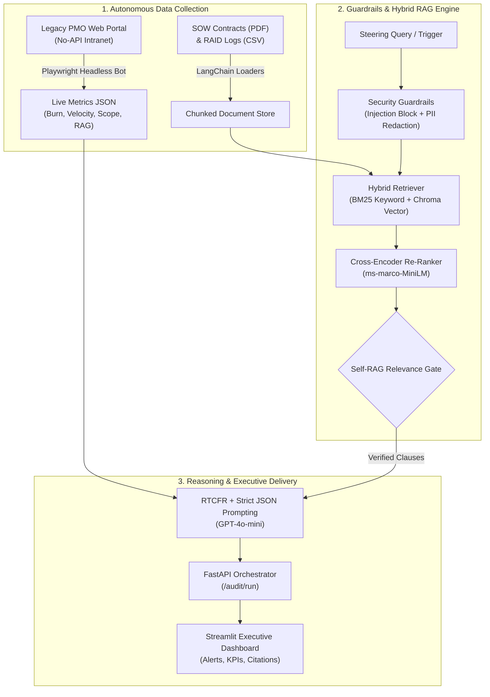

# 🛡️ GovGuard AI: Autonomous IT Program Governance & Delivery Risk Agent


**GovGuard AI** is an autonomous agentic AI co-pilot that acts as a **24/7 Program Governance Analyst**. It eliminates manual PMO audit bottlenecks by autonomously scraping live delivery metrics from legacy no-API portals via **RPA**, verifying contractual SLA thresholds via **Hybrid RAG**, and generating guardrailed, citation-backed risk escalations.

---

## 🚨 The Problem
In large-scale enterprise IT delivery, governance is fragmented and reactive:
1. **Unstructured Data Overload:** Crucial SLA thresholds and change-control rules are buried inside 100-page Statements of Work (SOWs), while live metrics live in legacy web trackers without REST APIs.
2. **Manual Audit Bottlenecks:** Program Managers spend hours manually cross-checking sprint velocity and budget burn against contract clauses.
3. **Delayed Risk Escalation:** Vendors often self-report **GREEN** statuses until budget overruns or unapproved scope creep have already derailed milestones.

---

## 🏗️ System Architecture



---

## 🛠️ Tech Stack & Curriculum Mapping

| Layer | Technology | Role in GovGuard AI |
| :--- | :--- | :--- |
| **RPA Automation** | **Playwright** | Headless browser bot extracting live budget burn, velocity variance, and vendor RAG status from legacy portals. |
| **Document Ingestion** | **LangChain & PyPDF** | Parses unstructured PDF contracts and CSV RAID logs into overlapping semantic chunks. |
| **Hybrid Retrieval** | **BM25 + ChromaDB** | Combines exact keyword matching (Clause IDs, percentages) with dense vector search. |
| **Re-Ranking & Self-RAG** | **Sentence-Transformers** | Uses `cross-encoder/ms-marco-MiniLM-L-6-v2` to score relevance and filter out low-confidence noise. |
| **Prompting & Security** | **RTCFR + Regex Guardrails** | Blocks prompt injections, masks PII/Employee IDs, and enforces deterministic JSON output. |
| **Backend & UI** | **FastAPI + Streamlit** | Asynchronous REST API powering an interactive Executive Steering Committee command center. |

---

## 📂 Repository Structure

```text
govguard-ai/
├── .env                        # API keys and portal URL configuration
├── requirements.txt            # Python dependencies
├── setup_demo_data.py          # Generates synthetic SOW PDF & RAID CSV
├── mock_portal/
│   └── legacy_portal.html      # Local legacy PMO portal for live RPA scraping
├── data/
│   ├── sow_contract.pdf        # Generated Statement of Work contract
│   └── raid_log.csv            # Generated RAID log
├── rpa/
│   └── legacy_portal_bot.py    # Playwright scraper module
├── rag/
│   ├── hybrid_retriever.py     # BM25 + Vector + Cross-Encoder + Self-RAG
│   └── guardrails.py           # Prompt injection & PII redaction filter
├── backend/
│   └── main.py                 # FastAPI governance orchestration server
└── frontend/
    └── app.py                  # Streamlit Executive Governance Dashboard
```

---

## 🚀 Quickstart Guide (Local Demo)

### 1. Clone & Set Up Virtual Environment
```bash
git clone https://github.com
cd govguard-ai
python -m venv venv
source venv/bin/activate  # On Windows: venv\Scripts\activate
pip install -r requirements.txt
playwright install chromium
```

### 2. Configure Environment Variables
Create a `.env` file in the root directory:
```env
OPENAI_API_KEY=sk-proj-your-api-key-here
LLM_MODEL=gpt-4o-mini
EMBEDDING_MODEL=text-embedding-3-small
LEGACY_PORTAL_URL=http://127.0.0
```

### 3. Generate Demo SOW Contract & RAID Data
```bash
python setup_demo_data.py
```

### 4. Launch the 3-Service Live Demo
Open three terminals in your virtual environment:

* **Terminal 1 — Serve the Mock Legacy Portal:**
  ```bash
  python -m http.server 8502 --directory mock_portal
  ```
* **Terminal 2 — Start the FastAPI Governance Engine:**
  ```bash
  uvicorn backend.main:app --reload --port 8000
  ```
* **Terminal 3 — Launch the Streamlit Executive Dashboard:**
  ```bash
  streamlit run frontend/app.py
  ```

---

## 📊 Sample Audit Detection
In the included demo scenario (**Core Banking Cloud Migration - Wave 2**):
* **Vendor Portal Self-Reported Status:** `GREEN`
* **GovGuard AI True Status:** `RED` *(Risk Score: 92/100)*
* **Detected Breaches:**
  * **Budget Burn (`86.5%`):** Exceeds the `80.0%` Milestone 3 threshold *(SOW Clause 7.1, Page 3)*.
  * **Unapproved Scope Creep (`11.2%`):** Exceeds the `5.0%` Change Request ceiling *(SOW Clause 4.2, Page 2)*.
  * **Sprint Velocity Variance (`-24.0%`):** Breaches the `-20.0%` two-sprint SLA limit *(SOW Clause 9.4, Page 4)*.